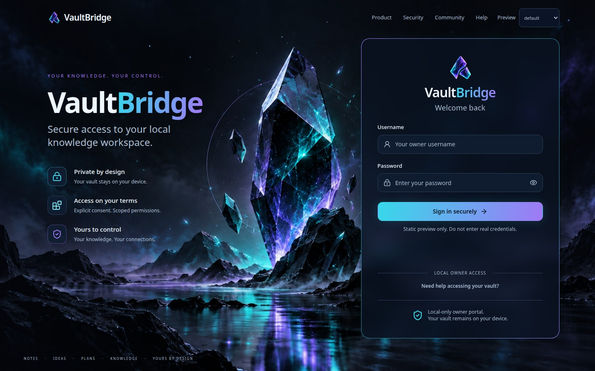

# FE-001 — Crystal frontend foundation

## Scope and base

Implemented from `develop` at `3a73530da5b44f401a62f8b7c0991d82a2051129`,
verified against the canonical GitHub repository on November 2, 2026.
Source contracts read: Obsidian FE-000, FE-UI-001, FE-PLAN-001, FE-001 and
AUTH-005A. This is only the first roadmap milestone, not the FE-002 cutover.

- Independent React + Vite + TypeScript preview in `web/`.
- Tailwind Vite integration, shadcn configuration/local primitives, Radix
  dialog/label/slot behavior, CVA variants, Lucide icons and React Router
  preview state selection.
- `VBButton`, `VBInput`, `VBCard`, `VBStatus` and `VBDialog` share the exact
  FE-UI-001 `--vb-*` contract. shadcn semantic aliases refer to those tokens.
  Palette, radius, control height and card shadow are not redefined by pages.
- Dark-only, system fonts, no remote fonts/assets/CDN at runtime.
- Static golden login: explicit labels/autocomplete, password visibility,
  required-field validation/focus, generic error, rate-limit feedback, loading,
  disabled and expired-session examples. Submit only validates locally, clears
  fields and explicitly reports that no credentials were sent.
- Desktop card stays on the **right** with the central crystal visible.
  Portrait tablet stacks the artwork above the card, like mobile, rather than
  covering the crystal with a narrow right-hand form. Narrow screens scroll
  naturally; controls remain at least 46px high.

### Newer user-supplied visual reference

During implementation, the user supplied a transparent crystal logo and a
complete login mockup, explicitly requesting that the product match that image.
The reference is preserved unchanged as
[`docs/design/fe-001-user-reference.png`](design/fe-001-user-reference.png).
The FE-UI-001 Obsidian contract records this approved visual update:

- Header wordmark/navigation, left-side headline and benefits, central original
  artwork, larger right-side glass panel, centered form logo/brand.
- Panel up to 560px (roughly one third of a desktop viewport), replacing the
  initial 420px maximum where appropriate.
- Cyan-to-violet brand/CTA gradient and thin panel outline, derived entirely
  from the unchanged canonical tokens. The CTA retains a dark label for
  contrast rather than copying low-contrast white text over bright cyan.
- The first attachment's actual transparent logo replaces the generic Gem icon.
  The master is `web/public/assets/vaultbridge-crystal-mark.png`, 1254×1254 RGBA,
  SHA-256 `a2efdebc474b82c64bae07920f7f4f79933486fe4bf94fdeda0bc055e2f161e2`.
  Source/installed-package checks also lock these original bytes.
- Mockup-only Google sign-in, signup, remember-me persistence and email reset
  are deliberately omitted. Username remains the existing owner's username,
  not a new email account flow. Benefits do not promise a new sync service.
- Preview-state controls remain visibly separate in the header. Production UI
  is still untouched.

Not implemented: live sign-in, recovery, mandatory rotation, consent, dashboard,
grants/clients/settings, API client, query cache, or backend changes.
Recovery guidance is an informational dialog, not an actionable reset flow.
Form state URLs contain only the selected state, never credential values.

## Original artwork provenance

- Source: user-provided `vaultbridge-login-background.png` in the original
  workspace, identified by the approved plans as the November 2 PNG.
- Master: `web/public/assets/obsidian-crystal-login-bg.png`.
- PNG, **1672 × 941**, retained byte-for-byte (no regeneration, mirroring,
  compression or editing).
- SHA-256: `09b3439af1755af8dc41a3c795d23368f5dc85af18343bc2b6e3fb5cf50615d4`.
- Source contract test and installed-package smoke both verify this checksum.
  CSS uses cover with the original orientation; mobile uses a separate hero.

## Build, packaging and security boundary

All frontend libraries/tools are root devDependencies. `web/package.json` is
private and uses the root installation; do not run a separate `npm install`
under `web/`. Keep new frontend-only dependencies in root devDependencies.
`npm run build` clears `dist` **once**, compiles the existing backend, and calls
`npm run build:web` to typecheck/build into `dist/owner-ui`. Vite does not clear
the backend output. The cross-platform `scripts/build-all.mjs` sends child
build logs to stderr so `npm pack --json` stays machine-readable through prepack.
Use the full root build before packaging; `build:web` alone
intentionally does not clean old hashed assets.

Existing `files: ["dist", …]` packaging includes the built preview automatically;
no source files, screenshot tooling, browser binaries or screenshots are shipped.
`prepack` still invokes the full build. Package smoke checks the installed
index, referenced JS/CSS and original artwork, confirms Vite is absent from
the production consumer, then runs the existing MCP round trips through both
executable names with a disposable vault.

`dev:web` and `preview:web` bind separate loopback-only development origins.
There is **no proxy to owner APIs**, no credential submission, no storage of
tokens or credentials, and no new Express static serving/fallback.
Relative bundle URLs prepare for future integration but do not enable it.

`src/auth/`, backend routing, SQLite, Better Auth configuration, signed OAuth
queries/state/PKCE, Host/TCP-peer/Origin/CSRF, CSP, SameSite/HttpOnly cookies,
rate limits and public/private listener separation are untouched. The actual
`/login`, `/consent`, `/admin` and `/owner.js` still use the legacy UI.
FE-002 must explicitly test same-origin integration and CSP compatibility,
including library portal behavior, before any production cutover. This preview
is **not** evidence of live OAuth/ChatGPT browser interoperability or permission
to release. Issue #60 remains outside this task.

## Reproduce

Use the supported Node range in the root package (baseline on 22.23.4;
final full gate on 24.22.1).

```bash
npm ci
npm run dev:web
# Separately, for the built artifact:
npm run build
npm run preview:web
```

The development server is `http://127.0.0.1:5173`; the production-build preview
is `http://127.0.0.1:4173`. Both are reference-only, not the owner listener.
Do not tunnel either preview.

```bash
npm run lint
npm test -- --maxWorkers=2
npm run build
npm run smoke:package
npm pack --dry-run
npx playwright install chromium
npm run verify:web
```

`verify:web` owns a Vite preview process, requires port 4173 free, and always
closes its browser/server. It writes screenshot evidence and `report.json`.
It asserts right/stacked placement, no horizontal overflow, desktop viewport
fit, no asset/browser errors, local-only GET requests (including after Enter),
cleared inputs/no browser storage, visibility toggle, validation focus,
dialog focus trap/Escape/focus restoration and reduced motion.
It uses axe WCAG A/AA checks on each viewport/state and the open dialog.
Automated checks do not constitute a full accessibility certification;
physical mobile keyboard and screen-reader testing remain manual follow-ups.

## Validation evidence

Baseline before edits: `npm ci`, lint, full tests (**733 passed, 1 skipped**),
build and package smoke all passed on Node 22.23.4. Existing auth/security tests
were not edited. Baseline installation already reported 11 moderate dependency
advisories; the frontend installation reports the same 11 moderate advisories
and no high/critical advisories. No unrelated dependency remediation is included.
GitNexus MCP was unavailable; source inspection and regression tests were used
instead, not an inferred clean graph result.

Final gate on Node **24.22.1**:

| Command / check | Result |
| --- | --- |
| `npm ci` | PASS (lockfile installation) |
| `npm run lint` | PASS, including type-aware frontend checks |
| `npm test -- --maxWorkers=2` | PASS: **39 files, 748 passed, 1 skipped** |
| `npm run build` | PASS: backend plus frontend typecheck/Vite bundle |
| `npm run smoke:package` | PASS: installed UI entries, exact PNG checksums, no Vite runtime, both CLI/MCP round trips |
| `npm pack --dry-run --json` | PASS: parseable JSON, bundled index/JS/CSS/background/logo; no source or screenshot tooling |
| `npm run verify:web` | PASS: six viewports, five extra form states, zero axe violations in checked views, keyboard/dialog/reduced-motion checks, no credential requests |

The frontend source/component checks also passed on Node 22.23.4
(**15 tests**). Production dependency declarations and all existing auth/OAuth
source/test files remain unchanged from the base.
Browser evidence below is captured from the production build, not Vite HMR
or a mocked picture.

### Responsive reference

| Viewport | Layout | Evidence |
| --- | --- | --- |
| 1672 × 941 | native mockup size, introduction left / form right | [Reference-size desktop](screenshots/fe-001/login-1672x941.jpg) |
| 1440 × 900 | right-side panel, central crystal visible | [Desktop](screenshots/fe-001/login-1440x900.jpg) |
| 1280 × 800 | right-side panel, central crystal visible | [Small desktop](screenshots/fe-001/login-1280x800.jpg) |
| 768 × 1024 | separate hero above opaque panel | [Portrait tablet](screenshots/fe-001/login-768x1024.jpg) |
| 390 × 844 | stacked, scrollable, no horizontal overflow | [Mobile](screenshots/fe-001/login-390x844.jpg) |
| 320 × 700 | stacked, scrollable, no horizontal overflow | [Narrow mobile](screenshots/fe-001/login-320x700.jpg) |



### States

[Error](screenshots/fe-001/login-error.jpg) ·
[Rate-limited](screenshots/fe-001/login-rate-limited.jpg) ·
[Loading](screenshots/fe-001/login-loading.jpg) ·
[Disabled](screenshots/fe-001/login-disabled.jpg) ·
[Expired](screenshots/fe-001/login-expired.jpg) ·
[Validation / keyboard focus](screenshots/fe-001/login-validation-focus.jpg) ·
[Machine-readable browser report](screenshots/fe-001/report.json)

## Rollback

Revert this frontend/build-only commit and rebuild the package. No database,
grant, token, listener or live route migration needs to be undone. Until FE-002,
the legacy owner UI is already the only UI served by the owner listener.
No merge, npm publication or tunnel change is authorized by FE-001.

## Follow-up — FE-002A

The preceding section records FE-001's state at its original implementation.
FE-002A adds a separate production owner entry without changing the FE-001
preview: the private owner server serves `/login` and `/recover` from the built
React bundle only when `MCP_OWNER_UI_MODE=react`; the default remains `legacy`.
The server-rendered consent/admin compatibility routes, public 39145/private
39146 topology and existing owner API contracts remain. See
[FE-002A implementation and test evidence](FE-002A-real-owner-login.md).
Consent, grants UI and dashboard are explicitly outside FE-002A.
